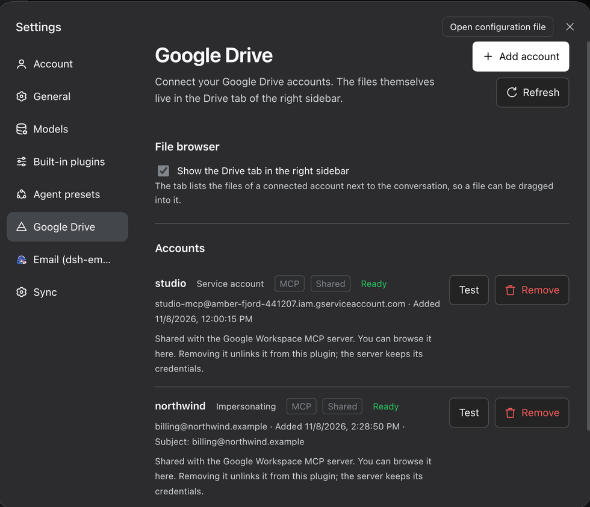
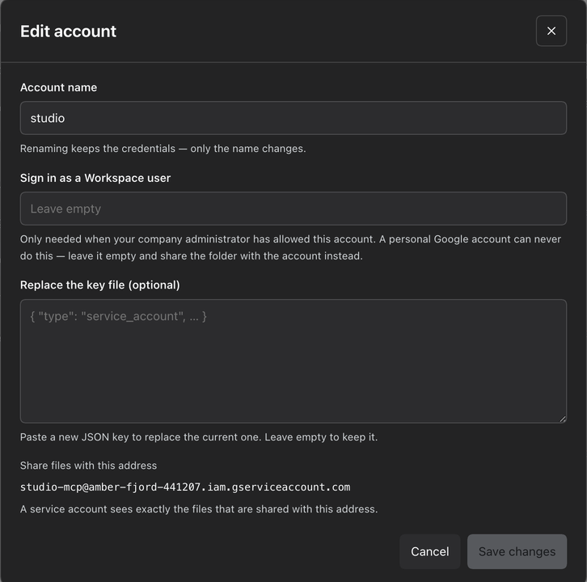
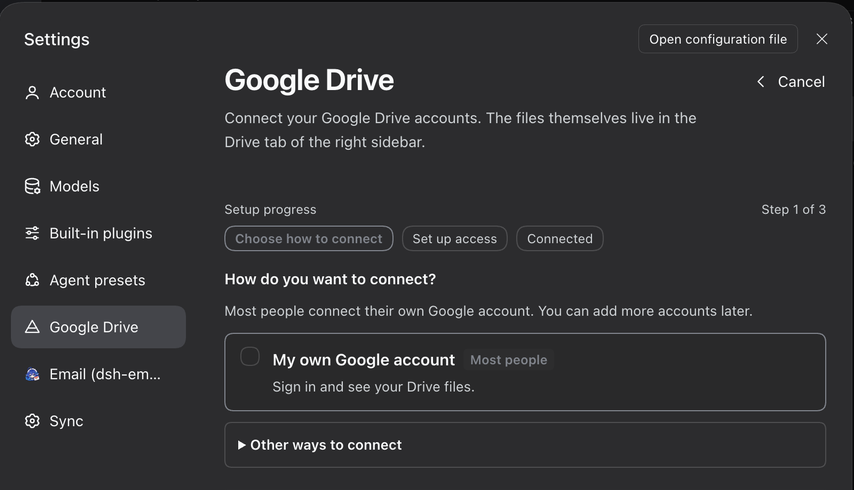
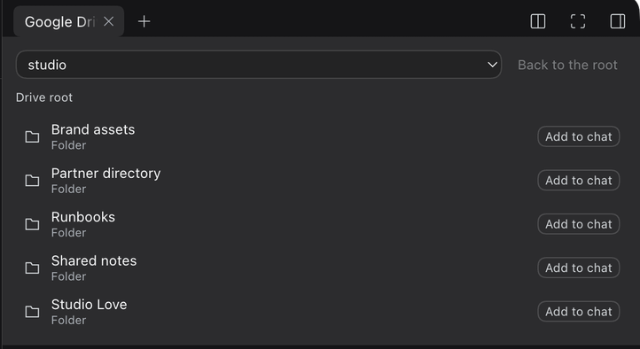

# dsh-google-drive

[](https://dsh-plugin.org/plugins/boldandigital/dsh-google-drive)

Connect Google Drive to the DeepSeek Harness.

The plugin has no entry in the left sidebar. Connected accounts live in
**Settings → Google Drive**, and the files live in the **Drive** tab of the
right sidebar, next to Workspace files, Browser and Terminal. A file can be
dragged into the conversation, so the agent works with the same Drive the user
does.

## Screenshots

The account names, the addresses and the file names in these screenshots are
invented. The real ones belong to whoever installed the plugin, so they stay
out of the repository.









## What it does

| | |
|---|---|
| **Settings section** | Settings → Google Drive lists the connected accounts, each with an **Edit** button (rename it, change the Workspace user it acts as, replace a rotated key, renew a Google sign-in), a **Test** button that checks the connection and a **Remove** button behind a confirmation, plus an Add account button, a refresh button and the storage/bridge information. An account the installed `google-workspace-mcp` server owns is listed too, marked **MCP**: its credentials are the server's, so it offers **Make editable** instead of an Edit button — one click and this plugin has its own copy of it, which the server keeps working with. |
| **Guided onboarding** | Add account opens a wizard: one primary choice — sign in with Google — with a service account and a Workspace delegation behind a disclosure. It opens the browser for you, explains what Google will say before you meet it, and names the way out of every dead end. |
| **Optional browser** | A toggle in the settings section turns the Drive tab in the right sidebar on or off. The choice is remembered, and the tab is gone the next time the app starts. |
| **Right-sidebar tab** | The Drive tab shows an account picker, a folder breadcrumb with a back button, and the folder's files. Each row carries a badge naming the kind: Google Sheet, Google Doc, Google Slides, Google Drawing, Google Form, Google Script, Folder, Shortcut, or the file's own extension (PDF, XLSX, …) for an ordinary file. |
| **Hand a file to the agent** | Drag a row into the conversation, or press **Add to chat** on it. The file arrives as a reference the agent can act on. |
| **`@` reference menu** | Typing `@` in the composer opens the harness reference menu, which also lists Google Drive files. |
| **Agent tools** | The same account list and file operations are exposed to the agent as `google_drive_*` tools. |
| **MCP bridge** | Accounts are mirrored into `~/.google-mcp/accounts.json`, so an installed `google-workspace-mcp` server picks a new account up on its next call — no restart. |

## Install

From the Plugin Manager's **Discover** tab, or directly from npm:

```sh
dsh plugin --profile web add dsh-google-drive
```

The package is also on npm as [`dsh-google-drive`](https://www.npmjs.com/package/dsh-google-drive),
so `npm install dsh-google-drive` works too. To run it straight from a checkout instead:

```sh
dsh plugin --profile desktop add "link:/path/to/dsh-google-drive"
```

### From the Discover tab

The plugin is listed in a plugin market index of its own. To see it there, add
the index source under **Plugins → Discover → Manage index sources**:

```text
https://boldandigital.github.io/dsh-plugin-index/index.json
```

The index is rebuilt from the npm registry every morning, so it never points at
a version the registry does not have.

Every channel this plugin appears in, and the two steps that still need a
person, are written down in [MARKETPLACES.md](MARKETPLACES.md).

## Compatibility and trust

| | |
|---|---|
| **DSH version** | `>=0.2.0` (`engines.dsh` in `package.json`). Node `>=22`. |
| **Platforms** | macOS, Linux and Windows. The OAuth flow signs in through a loopback URL on `http://localhost`, so the browser and the harness run on the same machine. |
| **Licence** | MIT. |
| **External service** | The Google Drive API, and Google Cloud Console only when you choose to create a service-account key there yourself. |
| **Permissions** | The plugin reads and writes the Drive of the accounts you connect, and downloads a file only when you ask for it. It never reads a file outside the connected account. |
| **Data** | Account names, file ids and file names are sent to the model when you hand a file to the agent, marked as untrusted data. Nothing else leaves the machine. |
| **Credentials** | Stays in the DSH credential store and the plugin's own `0600` key files. Secrets never reach the bundle patch, the profile file, a log or a prompt. |
| **Accounts** | Adding, replacing and removing an account is user-only; the agent cannot do it. |

## Configure

The bundle ships with sensible defaults. To change them, override the
`google-drive` row in your profile's `cordis.patch.yml`:

```yaml
- id: google-drive
  name: 'dsh-google-drive'
  config:
    scopes:
      - 'https://www.googleapis.com/auth/drive'
    defaultAccount: ''
    mcpBridge: true
    storeDir: ''
```

| Key | Default | Meaning |
|---|---|---|
| `scopes` | `['https://www.googleapis.com/auth/drive']` | OAuth scopes requested at sign-in. |
| `defaultAccount` | `''` | Account selected when the Drive tab opens. Empty means the first one. |
| `mcpBridge` | `true` | Mirror the registry into `~/.google-mcp` for `google-workspace-mcp`. |
| `storeDir` | `''` | Registry and credential directory. Empty means `~/.google-mcp`. |
| `oauthClientId` | `''` | The sign-in key the plugin ships. When it is set, a user signs in with one click instead of building a client in the Cloud console. |
| `oauthClientSecret` | `''` | The secret of that key. The plugin only ever signs in through a loopback callback, which Google calls a desktop application — and for those "the client secret is obviously not treated as a secret". |

## Where the credentials live

Secrets never touch the bundle patch, the profile file, or a log.

| What | Where |
|---|---|
| Account metadata, OAuth client, refresh token, service key | The DSH credential store (`~/.dsh/.credentials.yaml`), under `google-drive/…` records. |
| Credential files the Drive library reads | `<storeDir>/tokens/<name>.json` and `<storeDir>/keys/<name>.json`, mode `0600`. |
| The registry `google-workspace-mcp` reads | `<storeDir>/accounts.json`. |

Each service account gets **its own copy** of the key file. Removing one
account never deletes a key another account still points at.

## Which sign-in should I use?

**Most people should sign in with their own Google account.** It is the only
route that shows the files you can already see in drive.google.com, and it
needs no administrator.

| You want… | Use | What it costs |
|---|---|---|
| Your own Drive files, and files shared with you | **Sign in with Google** | One visit to the Google Cloud console to create a sign-in key. |
| One folder, for automation or for a script | **A service account** | A Google Cloud project, and you must share the folder with the account's address. |
| A company Workspace, as one of its users | **Domain-wide delegation** | A Workspace super administrator has to allow the app; Google can take up to a day to apply it. |

Google classifies `…/auth/drive` as a *restricted* scope, so an app that
requests it has to pass Google's verification before it can be published to
everybody. Until it does, Google shows an "app is not verified" warning during
the sign-in; the answer is *Advanced → Go to …*. A service account sidesteps
the consent screen entirely: it needs no OAuth approval, and access is granted
by sharing a file or folder with the service account's email address — but it
sees **only** what you share with it.

For a service account:

1. In Google Cloud Console, create a service account and download its key.
2. Share the Drive folder you need with the account's `client_email`.
3. Choose the key file in the wizard. With the gcloud command line tool
   installed and signed in, the wizard can create the key for you instead.

**Domain-wide delegation** (the optional "act as" field) lets the service
account act as a Workspace user with that user's full Drive access. A Workspace
super-admin must first authorise the service account's client id under
*Admin console → Security → Domain-wide delegation*, and Google can take up to
24 hours to apply the change.

**Sign in with Google** is for the files a specific person can see but has not
shared with anyone. The plugin signs in through a loopback consent URL on
`http://localhost`, so it needs a **Desktop app** OAuth client — Google
rejects a localhost callback for a web client. The wizard walks through
creating one in Google Cloud Console and reads the downloaded JSON file in the
browser, so the client id and secret do not have to be typed. The sign-in must
complete on the same machine.

## Handing a file to the agent

Drag a row from the Drive tab into the conversation, or press **Add to chat**
on it. The composer keeps the file as a reference chip.

When the message is sent, the plugin names the account, the file id and the
file in the prompt, so the agent knows which Drive file is meant and which
tool reads it: `google_drive_download_file` for a file,
`google_drive_list_files` for a folder, and `google_drive_search_files` for
other files in the same account. The file names are marked as untrusted user
data.

## Agent tools

| Tool | Arguments |
|---|---|
| `google_drive_list_accounts` | — |
| `google_drive_list_files` | `account`, `folderId?`, `pageSize?` |
| `google_drive_search_files` | `account`, `query`, `pageSize?` |
| `google_drive_download_file` | `account`, `fileId`, `path`, `exportFormat?` |
| `google_drive_upload_file` | `account`, `localPath`, `name?`, `folderId?`, `mimeType?` |

Adding, replacing and removing an account stays **user-only**. Those actions
grant authority, so the agent cannot perform them.

## Development

```sh
node --check lib/index.js
node --check lib/client.js
node --check lib/client.onboarding.js
node --check lib/client.sidebar.js
```

The bundle has no build step and no runtime dependencies beyond Node's
standard library.

## Notes

- A service account sees the items shared with it at the top of its Drive, and
  Drive reports those items with **no parent at all**. The usual
  `'root' in parents` filter therefore matches nothing and the account looks
  empty — the upstream `google-workspace-mcp` server has this blind spot too,
  and its `listFolderContents` reports an empty folder for an account whose
  files are plainly visible. This plugin lists the root of a service account
  with the negated query and keeps the genuinely top-level items.
- `nextPageToken` is not surfaced in the Drive tab, so the file list shows the
  first page only.
- The account picked in the Drive tab is client-side state and resets to the
  first account when the app is reloaded.
- An account that belongs to the `google-workspace-mcp` server is listed in
  the settings section. Its credentials belong to that server, so removing
  it here only unlinks it: the plugin stops offering the account and the
  server keeps its own copy. Remove it in the MCP server's own settings to
  delete the credentials.
- Turning the Drive tab off removes the plugin's view of it. A tab that was
  already open then shows the harness's empty-tab placeholder until it is
  closed; a new session never opens it at all.

## Licence

MIT — see [LICENSE](LICENSE).
