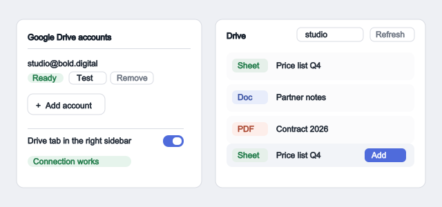
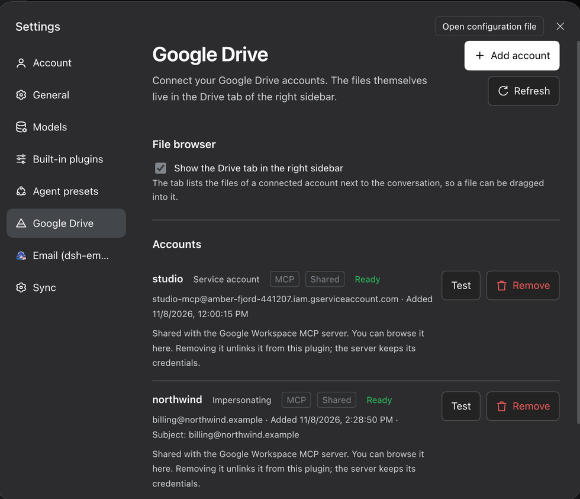
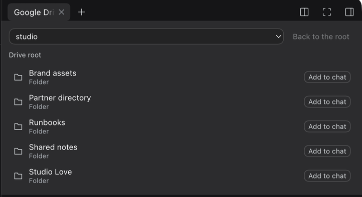

# Google Drive accounts

Connect a Google Drive account to the Harness, browse its files beside the
conversation, and drag a file straight into the chat when the agent needs it.

## Connect an account

Press **Add account** in the settings section. The wizard opens with one
question — *which of these is your situation?* — and shows only the route
that fits:

- **My own Google account** — the plugin looks for an OAuth client this Mac
  already has, picks it, and opens Google's sign-in. Only a *Desktop app*
  client works, because Google refuses a `localhost` callback for a web
  client; the wizard says so in three console steps and then only asks for
  the downloaded JSON file, which fills the client id and secret in for you.
- **A service account** — for automation and for files that are shared with
  a service account. It needs no administrator: share the folder with the
  account's own address, and the wizard shows you that address as soon as
  the key is in.
- **My company uses Google Workspace** — the one route that needs an
  administrator: a service account that acts as a user through domain-wide
  delegation. The wizard says plainly that a personal Google account cannot
  delegate, so nobody spends an afternoon in an admin console that has no
  such setting.

Either way the sign-in happens on this machine, and the credentials never
leave it.

## Change an account

Every account this plugin owns has an **Edit** button, so an account is not a
one-way door:

- **Rename** it — the credentials move with it.
- **Act as a Workspace user** — set, change or take away the user a service
  account impersonates. Clearing the field is what turns a delegation that
  cannot work into a plain service account that sees the files shared with
  it.
- **Replace the key file** — paste a new key when one is rotated.
- **Sign in again** — renew a Google sign-in whose access expired. The OAuth
  client is already stored, so this is one click and no client id to find.

The **Test** button asks Google whether the credentials really work, and the
section says what came back, in green or in red.

## Browse the files

The connected account's files live in the **Drive** tab of the right sidebar,
next to Workspace files, Browser and Terminal. Each row carries a badge
naming the kind of file it is — Google Sheet, Google Doc, Google Slides,
Google Drawing, Google Form, Google Script, Folder, Shortcut — or the file's
own extension for an ordinary file.

## Hand a file to the agent

Drag a row into the conversation, or press **Add to chat** on it. The file
arrives as a reference chip, and the agent knows which account it came from
and which tool reads it: `google_drive_download_file` for a file,
`google_drive_list_files` for a folder, `google_drive_search_files` for the
rest of that account.

Typing `@` in the composer opens the reference menu, which lists Drive files
next to everything else.

## What the agent can do

| | |
|---|---|
| `google_drive_list_accounts` | The accounts this machine can use. |
| `google_drive_list_files` | The files of a folder. |
| `google_drive_search_files` | The files of an account that match a name. |
| `google_drive_download_file` | A file into the workspace, exported when it is a Google document. |
| `google_drive_upload_file` | A file from the workspace to Drive. |

Adding, replacing and removing an account stays with the user. Those actions
grant authority, so no agent can perform them.

## Which sign-in should I use?

**A service account, unless the files you need belong to a person who has not
shared them.** Google classifies `…/auth/drive` as a restricted scope, and an
app that requests it in production has to pass Google's verification. A
service account sidesteps that: no consent screen, and access is granted by
sharing a folder with the account's email address.

**OAuth** is the one to choose when you need the files a specific person can
see but has not shared with anyone.

## The status of an account means something

The **Test** button asks Google whether the credentials really work, and the
section says what came back. An account that cannot sign in — a service
account whose client id no Workspace administrator authorised, for instance —
says so in as many words, with the reason Google gave, and with the two ways
out that need no administrator: share the folder with the service account, or
connect the Google account itself.

## The credentials stay here

Secrets never reach the bundle patch, the profile file or a log. Each service
account gets its own private copy of its key, and removing one account never
deletes a key another account still points at. An account that belongs to an
installed `google-workspace-mcp` server is listed but read-only here:
removing it unlinks it, and the server keeps its own copy.
