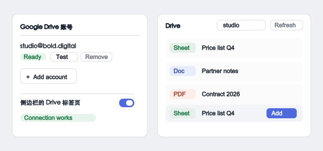
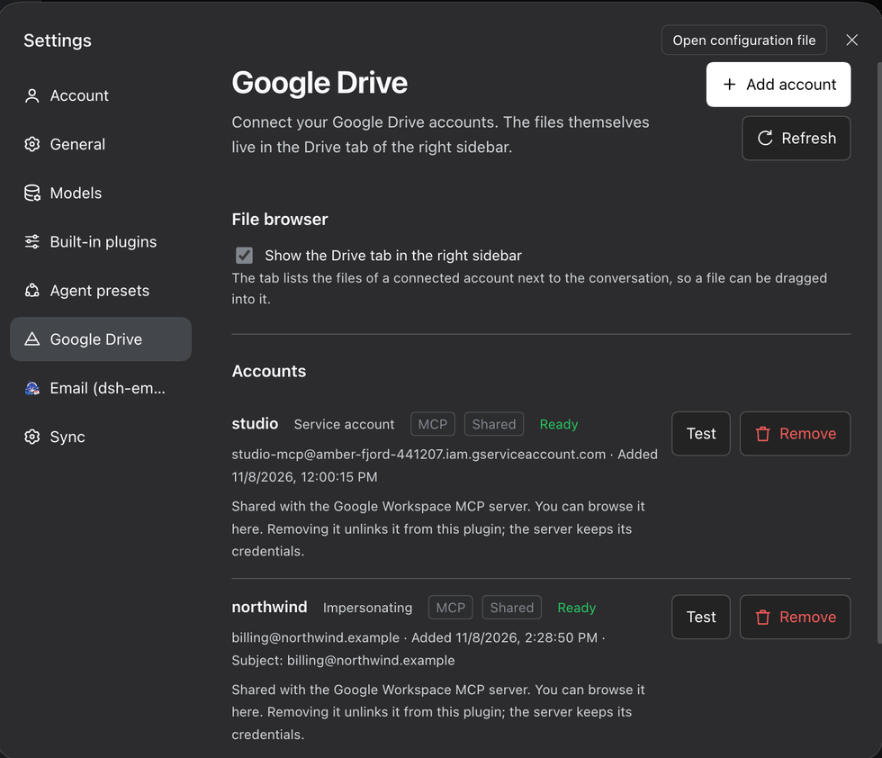
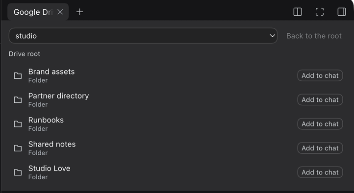

# Google Drive 账号

把一个 Google Drive 账号接入 Harness，在对话旁边浏览它的文件，需要的时候把
文件直接拖进对话交给智能体。

## 接入账号

在设置里按 **Add account**。向导先问一句话——*你属于哪种情况？*——然后只
显示对应的那一条路径：

- **我自己的 Google 账号** —— 插件会在这台 Mac 上已有的 OAuth 客户端里挑出
  可用的一个，直接打开 Google 的登录。只有 *Desktop app* 客户端能用，因为
  Google 不接受网页客户端的 `localhost` 回调；向导用三步说明怎么创建，然后
  只要你选中下载好的 JSON 文件，客户端 ID 和密钥就自动填好了。
- **服务账号** —— 适合自动化，也适合那些共享给服务账号的文件。它不需要管理
  员：把文件夹共享给账号自己的地址即可，密钥一填好，向导就把这个地址显示
  出来。
- **公司使用 Google Workspace** —— 唯一需要管理员的路径：让服务账号通过域级
  委派代表某个用户操作。向导会直说个人 Google 账号无法委派，免得有人在
  根本没有这个设置的管理控制台里找一下午。

两种方式都在本机完成登录，凭证不会离开这台机器。

## 修改账号

本插件拥有的每个账号都有 **Edit** 按钮，账号不是一次定终身：

- **改名** —— 凭证跟着一起走。
- **代表某个 Workspace 用户** —— 设置、更换或取消服务账号要代表的用户。把这一
  项清空，就是把一份行不通的委派变成普通的、只看到共享给自己的文件的服务账
  号。
- **替换密钥文件** —— 密钥轮换时粘贴新的那一份。
- **重新登录** —— 给访问权过期的 Google 登录续期。OAuth 客户端已经存着，所
  以这只是一次点击，不用再去找客户端 ID。

**Test** 按钮会问 Google 凭证到底能不能用，设置里如实告诉你结果，绿色或红
色。

## 浏览文件

账号里的文件在右侧边栏的 **Drive** 标签页中，就在 Workspace files、Browser
和 Terminal 旁边。每一行都带一个徽标，说明这是什么类型的文件 —— Google
Sheet、Google Doc、Google Slides、Google Drawing、Google Form、Google
Script、Folder、Shortcut；普通文件则显示它自己的扩展名。

## 把文件交给智能体

把一行拖进对话，或者按它旁边的 **Add to chat**。文件会变成一个引用卡片，
智能体知道它来自哪个账号、该用哪个工具读取：文件用
`google_drive_download_file`，文件夹用 `google_drive_list_files`，同一个
账号里的其他文件用 `google_drive_search_files`。

在输入框里敲 `@` 会打开引用菜单，Drive 文件和别的引用并列其中。

## 智能体能做什么

| | |
|---|---|
| `google_drive_list_accounts` | 这台机器可以使用的账号。 |
| `google_drive_list_files` | 某个文件夹里的文件。 |
| `google_drive_search_files` | 某个账号里名字匹配的文件。 |
| `google_drive_download_file` | 把文件下载到工作区；Google 文档会先导出。 |
| `google_drive_upload_file` | 把工作区里的文件上传到 Drive。 |

添加、替换和删除账号始终由你自己来。这些动作意味着授予权限，所以智能体
不能替你做。

## 该用哪一种登录

**除非你要找的是某个还没有共享给任何人的私人文件，否则用服务账号。**
Google 把 `…/auth/drive` 列为受限权限，正式上线的应用申请它需要通过 Google
的验证；服务账号绕开了这一步：不需要同意页面，把文件夹共享给账号的邮箱
地址就行。

**OAuth** 适合那种「只有某个特定的人能看到、但他没有共享给任何人」的文件。

## 账号状态是有意义的

**Test** 按钮会问 Google 凭证到底能不能用，设置里如实告诉你结果。签不了
入的账号 —— 比如某个服务账号的 client id 还没有被 Workspace 管理员授权
—— 会直接说明原因，连 Google 给出的理由一起，并且给出两条不需要管理员的出
路：把文件夹共享给服务账号，或者直接连接那个 Google 账号本身。

## 凭证留在这里

密钥不会进入 bundle patch、配置文件或日志。每个服务账号都有自己私有的密钥
副本，删除一个账号绝不会删掉另一个账号还在引用的密钥。属于已安装的
`google-workspace-mcp` 服务器的账号在这里是只读的：删除只是解除关联，服
务器仍保留自己那份。
